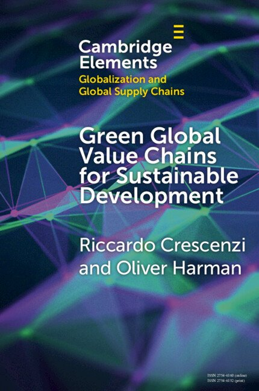

```{=html}
<figure class="book-cover">
  
  <figcaption>Cambridge University Press, October 2026</figcaption>
</figure>
```

Decarbonisation and wider sustainability need capital, skills and knowledge,
and mobilising them at the scale required remains a formidable challenge. In
this Element,
[Riccardo Crescenzi](https://www.lse.ac.uk/geography-and-environment/people/academic-staff/riccardo-crescenzi)
and I argue that green global value chains, together with the green foreign
direct investment that helps to build and reconfigure them, are central to that
shift, and that they can support sustainable development across a fragmented
spatial economy.

Our organising idea is environmental upgrading. Participation in these chains
can move firms, regions and countries towards cleaner production and
higher-value activities, and in doing so it reshapes natural capital. The
Element is short, at 75 pages, and it is written for researchers and for the
governments and agencies that have to act on this agenda.

[**[Pre-order from Cambridge University Press](https://www.cambridge.org/gb/universitypress/subjects/politics-international-relations/political-economy/green-global-value-chains-sustainable-development-environmental-upgrading-fragmented-spatial-economy)** &nbsp;·&nbsp; Open access on Cambridge Core from publication]{.fields}

## Launch event

::: {.featured}
[LSE public event, 18 November 2026]{.label}

[Can global value chains go green? Trade, investment and the net-zero development challenge]{.paper-title}

A panel on the questions behind the Element, with Erik Berglöf (Asian Infrastructure
Investment Bank), Riccardo Crescenzi, Ralph de Haas (European Bank for Reconstruction
and Development), Daria Taglioni (World Bank) and me, chaired by Jonathan Pershing,
Dean of LSE's Global School of Sustainability. Hosted by the Department of Geography
and Environment, the Global School of Sustainability and the International Growth
Centre.

6.30pm to 8pm, on campus and online.
[Details and how to join](https://www.lse.ac.uk/events/global-value-chains)
:::

## What the Element does

::: {.pubs}
- **Environmental upgrading**
  [How participation in green global value chains can move firms, regions and countries towards cleaner production and higher-value activities, and how it reshapes natural capital.]{.desc}

- **The Green Smile Curve, with a typology of chains**
  [A unified conceptual perspective on how global value chains shape environmental and development outcomes, distinguishing green, brown and ordinary chains.]{.desc}

- **The geography of green foreign direct investment**
  [New empirical evidence on where green foreign direct investment goes.]{.desc}

- **A policy framework**
  [A framework sensitive to green global value chains, centred on building, embedding and reshaping them, to help governments make use of them.]{.desc}
:::

<details class="abstract">
<summary>Publisher's description</summary>

In a world facing environmental transformation, mobilising the capital, skills, and knowledge required for decarbonisation and wider sustainability remains a formidable challenge. We argue that Green Global Value Chains (GGVCs)—and the Green Foreign Direct Investment (GFDI) that helps to build and reconfigure them—are central to this shift and can support sustainable development across a fragmented spatial economy. We advance the concept of environmental upgrading, showing how participation in GGVCs can move firms, regions, and countries towards cleaner production and higher-value activities while reshaping natural capital. This work has three aims. First, it offers a unified conceptual perspective on how GVCs shape environmental and development outcomes, introducing the Green Smile Curve and a typology of green, brown, and ordinary value chains. Second, it provides new empirical evidence on the geography of GFDI. Third, it proposes a GGVCs-sensitive policy framework—centred on building, embedding, and reshaping value chains—to help governments leverage GGVCs.

</details>

## Publication details

::: {.book-meta}
- [Authors]{.k} [Riccardo Crescenzi](https://www.lse.ac.uk/geography-and-environment/people/academic-staff/riccardo-crescenzi) and Oliver Harman, London School of Economics and Political Science
- [Series]{.k} Elements on Globalization and Global Supply Chains, Cambridge University Press
- [Published]{.k} October 2026, 75 pages
- [Formats]{.k} Paperback (ISBN 9781009623759), hardback and ebook, and open access on Cambridge Core
:::

## Earlier and shorter versions

::: {.pubs}
- **The argument in brief**
  [Written for the Regional Studies Association and for the LSE blog on global investments and local development, under the earlier title *Green Global Value Chains for Sustainable Regional Development*]{.venue}
  [[RSA blog](https://www.regionalstudies.org/rsa-blog/blog2023sss24651/) [GILD blog](https://blogs.lse.ac.uk/gild/2024/03/19/green-global-value-chains-for-sustainable-regional-development/)]{.links}

- **Harnessing Global Value Chains for Regional Development: How to Upgrade through Regional Policy, FDI and Trade**
  [[Crescenzi, R.](https://www.lse.ac.uk/geography-and-environment/people/academic-staff/riccardo-crescenzi), and Harman, O. (2023). Regional Studies Policy Impact Book Series, Routledge. [doi:10.4324/9781003356141](https://doi.org/10.4324/9781003356141)]{.venue}
  [The earlier book, on upgrading through regional policy, foreign investment and trade, which this Element takes into the green transition]{.desc}
  [[Book](https://www.taylorfrancis.com/books/mono/10.4324/9781003356141/harnessing-global-value-chains-regional-development-riccardo-crescenzi-oliver-harman) [Overview (open access)](https://www.tandfonline.com/doi/full/10.1080/2578711X.2022.2099155)]{.links}

- **Green Foreign Direct Investment in Africa**
  [[Alvarez-Vilanova, J.](https://www.lse.ac.uk/geography-and-environment/people/phd-students/juan-alvarez-vilanova), [Crescenzi, R.](https://www.lse.ac.uk/geography-and-environment/people/academic-staff/riccardo-crescenzi), Harman, O., and [Lippitsch, C.](https://sites.google.com/view/christianlippitsch)]{.authors}
  [Working paper, in preparation]{.venue}
  [Companion empirical work on the geography of green investment, classifying 9,935 greenfield projects against the EU and Rwandan green taxonomies. [More on the research page](research.qmd#working-papers)]{.desc}
:::

## Talks and media

::: {.talks}
- [2026]{.date} ["Made in Britain, or designed in Britain? What Port Talbot teaches us about the green economy"](https://blogs.lse.ac.uk/businessreview/2026/06/13/made-in-britain-or-designed-in-britain-what-port-talbot-teaches-us-about-the-green-economy/), with Riccardo Crescenzi, in LSE Business Review
- [2025–]{.date} [RSA Research Network on Green(ing) Global Value Chains for Sustainable Regional Development](https://www.regionalstudies.org/network/ggvc4srd/), with V. De Marchi, R. Crescenzi and C. Hulke
- [2024]{.date} *Green Global Value Chains for Sustainable Regional Development*. International Business Seminar, Henley Business School, University of Reading
- [2023]{.date} *Green Global Value Chains for Sustainable Regional Development*. [Opening plenary, RSA Summer Conference, Ljubljana (video)](https://www.youtube.com/watch?v=sNRER6fGE9c)
:::

[**Also on the green transition:** [Sustainability in a fragmented world (RSA video)](https://www.youtube.com/watch?v=Vlg8Ty7w7tQ) [Should we still care about net zero? (LSE iQ podcast)](https://www.lse.ac.uk/lse-player/should-we-still-care-about-net-zero)]{.media}

If you would like to discuss the Element, or to use it in teaching or in
policy work, my email is <o.harman@lse.ac.uk>.
