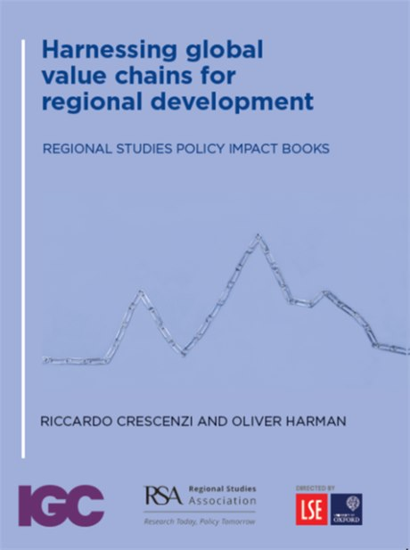

```{=html}
<figure class="book-cover sea">
  
  <figcaption>Routledge, 2023</figcaption>
</figure>
```

[Riccardo Crescenzi](https://www.lse.ac.uk/geography-and-environment/people/academic-staff/riccardo-crescenzi)
and I wrote this book for the people who have to make regional policy decisions.
It asks what a region can realistically do about its position in global
production, and it works through the levers a regional government holds, which
are its own policy, the foreign investment it attracts and the trade it carries.
Routledge published it in 2023 in the Regional Studies Policy Impact Book series,
and the overview chapter is open access.

Since publication the book has been reviewed in three journals and in the
financial press, cited in policy documents from the World Bank, the OECD and the
United Nations, used in evidence to two House of Commons committees and to the
Harrington Review, and worked through with investment promotion agencies in
Asia, Africa and Europe. What follows is that record, drawn from the book's
impact and engagement report of May 2025.

[**[Book](https://www.taylorfrancis.com/books/mono/10.4324/9781003356141/harnessing-global-value-chains-regional-development-riccardo-crescenzi-oliver-harman)** &nbsp;·&nbsp; [Overview chapter, open access](https://www.tandfonline.com/doi/full/10.1080/2578711X.2022.2099155) &nbsp;·&nbsp; [Chapter 2, author's version](https://researchonline.lse.ac.uk/id/eprint/141230/1/Crescenzi_Harman_2022_Ch2_GVCs_regions.pdf) &nbsp;·&nbsp; [Associated materials](https://blogs.lse.ac.uk/gild/books/) &nbsp;·&nbsp; [doi:10.4324/9781003356141](https://doi.org/10.4324/9781003356141)]{.fields}

## Reviews

::: {.quote-lead}
Crescenzi and Harman have crafted an important work that bridges theory with
actionable insights, offering a roadmap for regions keen on leveraging GVCs for
sustainable growth.

[Ricardo Hausmann, Harvard Kennedy School, in *Regional Studies*]{.who}
:::

::: {.quote-lead .sea}
A book that does a great job presenting the opportunities of GVC integration. It
is highly valuable, not only for policy makers but also for researchers and
students.

[Sören Scholvin, University of Cologne, in *Economic Geography* (2023)]{.who}
:::

::: {.quote-lead .cobalt}
The book provides tools and insights for policy-makers to navigate the changing
landscape of value chains and regional development.

[Syahputra Rambe, Sulistiani and Rambasae, in *European Planning Studies* (2024)]{.who}
:::

The Financial Times' *fDi Intelligence* reviewed the book as
[a new template for regions to harness global value chains](https://www.fdiintelligence.com/content/feature/a-new-template-for-regions-to-harness-global-value-chains-81785),
and LSE listed it among its
[recommended reads for understanding the economy today](https://www.lse.ac.uk/research/research-for-the-world/economics/recommended-reads-for-understanding-the-economy-today).

## Cited in policy documents

The documents below cite the book or the working draft that preceded it. The
list comes from the book's impact report and from Overton, and was last added
to in October 2026.

::: {.pubs}
- **Asian Infrastructure Investment Bank**
  [The framework behind the book shaped the bank's 2021 flagship report, *Asian Infrastructure Finance 2021: Sustaining Global Value Chains*, for which we wrote Chapter 6 on infrastructure development and global value chains]{.desc}
  [[Chapter](https://www.aiib.org/en/news-events/asian-infrastructure-finance/_common/pdf/AIIB-Asian-Infrastructure-Finance-2021.pdf#page=74)]{.links}

- **World Bank**
  [[*An Investment Perspective on Global Value Chains*](https://openknowledge.worldbank.org/entities/publication/49fa218e-d636-55a7-94ac-7e5b552aa73c); [*Using Investment Policies to Stimulate Global Value Chain Participation*](https://elibrary.worldbank.org/doi/abs/10.1596/978-1-4648-1683-3_ch4)]{.venue}

- **OECD**
  [[*Does FDI Benefit Incumbent SMEs?*](https://www.oecd-ilibrary.org/urban-rural-and-regional-development/does-fdi-benefit-incumbent-smes_47763241-en); [*Measuring the Attractiveness of Regions*](https://www.oecd.org/cfe/measuring-the-attractiveness-of-regions-fbe44086-en.htm); [*Rethinking Regional Attractiveness in the New Global Environment*](https://www.oecd.org/publications/rethinking-regional-attractiveness-in-the-new-global-environment-a9448db4-en.htm); [*Subnational Investment Promotion and Decentralisation in the OECD*](https://www.oecd.org/en/publications/subnational-investment-promotion-and-decentralisation-in-the-oecd_ffd0927d-en.html); [*Connecting FDI and SMEs for Productivity and Innovation in Europe*](https://doi.org/10.1787/9848e952-en) (2026); [*Assessing the Socio-economic Impact of Foreign Direct Investment in Latin America and the Caribbean*](https://doi.org/10.1787/fd8fb41c-en) (2025), also [in Spanish](https://doi.org/10.1787/13c7d291-es); [*Place-based Industrial Policy*](https://doi.org/10.1787/43edc0df-en); [*OECD Economic Surveys: Ukraine 2025*](https://doi.org/10.1787/940cee85-en); [*Enhancing Rural Innovation in Canada*](https://doi.org/10.1787/a9919c66-en); *FDI Qualities Review of Croatia*]{.venue}

- **European Union**
  [[*The Human-Centred City*](https://op.europa.eu/en/publication-detail/-/publication/5b85a079-2255-11ea-af81-01aa75ed71a1/language-en); [*Foreign Direct Investment, Global Value Chains and Regional Economic Development in Europe*](https://op.europa.eu/en/publication-detail/-/publication/f5396c1c-db7c-11ea-adf7-01aa75ed71a1); [*Where Global Value Chains Go Local*](https://ec.europa.eu/regional_policy/information-sources/publications/reports/2022/where-global-value-chains-go-local-eu-regions-global-value-chain-creation-and-local-upgrading_en); [*Forging a Sustainable Future Together*](https://doi.org/10.2776/143512); and, from the European Parliamentary Research Service, [*The Future of EU Cohesion: Scenarios and Their Impacts on Regional Inequalities*](https://www.europarl.europa.eu/RegData/etudes/STUD/2024/762854/EPRS_STU(2024)762854_EN.pdf)]{.venue}

- **Asian Development Bank**
  [[*Buyer Market Power, Transport Mode, and Exchange Rate Shocks*](https://www.adb.org/sites/default/files/publication/1101346/ewp-825-buyer-market-power-transport-mode.pdf), ADB Economics Working Paper 825 (2025)]{.venue}

- **Centre for Inclusive Trade Policy**
  [[*European Regional Resilience to Supply Shocks Diffused through Global Value Chains*](https://citp.ac.uk/wp-content/uploads/2025_European-regional-resilience-to-supply-shocks-diffused-through-GVCs_CITP_WP028.pdf), CITP Working Paper 028 (2025)]{.venue}

- **Environment for Development**
  [*Global Sustainability in an Interconnected World: The Role of the EU in Trade and Value Chains*, written for the EU's Sustainability Performances, Evidence and Scenarios project (2026)]{.venue}

- **World Intellectual Property Organization**
  [[*The Geography of Innovation: Local Hotspots, Global Networks*](https://www.wipo.int/edocs/pubdocs/en/wipo_pub_944_2019.pdf) and its [companion report on global innovation networks](https://www.wipo.int/publications/en/details.jsp?id=4471)]{.venue}

- **United Nations**
  [Economic Commission for Latin America and the Caribbean, [*Foreign Direct Investment in Latin America and the Caribbean 2024*](https://digitallibrary.un.org/record/4067510); United Nations Development Programme, [*Human Development Report 2023/24: Breaking the Gridlock*](https://hdr.undp.org/system/files/documents/global-report-document/hdr2023-24reporten.pdf)]{.venue}
:::

## Evidence to parliaments and reviews

::: {.pubs}
- **House of Commons International Trade Committee**
  [Written evidence on inward foreign direct investment, drawn on in the committee's report and its recommendations to government]{.desc}
  [[Evidence](https://committees.parliament.uk/writtenevidence/23003/pdf/) [Committee report](https://publications.parliament.uk/pa/cm5802/cmselect/cmintrade/124/report.html)]{.links}

- **House of Commons Welsh Affairs Committee**
  [Written and oral evidence drawing on the book]{.desc}
  [[Written evidence](https://committees.parliament.uk/writtenevidence/133366/pdf/) [Oral evidence session](https://committees.parliament.uk/event/23794)]{.links}

- **Harrington Review of Foreign Direct Investment**
  [Written evidence drawing on the book]{.desc}
  [[Review report](https://assets.publishing.service.gov.uk/media/655f62310c7ec8001195bd5f/231123_Harrington-Review-Report-FINAL-2__HH_Global_.pdf)]{.links}
:::

## Used by governments and agencies

::: {.pubs}
- **Investment promotion agencies**
  [Presented to the Bangladesh Investment Development Authority, Indonesia's investment promotion centre, Madrid Investment Attraction, and the Malaysian Investment Development Authority with MATRADE and the Ministry of Investment, Trade and Industry. Research has continued out of several of those discussions.]{.desc}

- **Urban Unit, Punjab, Pakistan**
  [The unit's chief executive described wanting to map where value chains and their suppliers sit in Lahore, following one of the book's recommendations]{.desc}

- **Zanzibar Research Centre for Socio-Economic and Policy Analysis**
  [A policy brief written from the book for a roundtable at the African School of Economics in Zanzibar, which grew into our 2026 paper on [upgrading in Zanzibar](policy.qmd#global-value-chains-and-local-development)]{.desc}

- **Ministries across West and East Africa**
  [A presentation on infrastructure for African integration into global value chains, to officials from the ministries responsible for economy, finance and trade in Côte d'Ivoire, Djibouti, Senegal and Togo]{.desc}

- **Connected Places Catapult**
  [An applied toolkit for local governments in the North of England, *Leveraging Opportunities from Global Value Chains for Regional Development*]{.desc}

- **UNU-WIDER and the African Cities Research Consortium**
  [Findings presented at a workshop on African urbanisation and structural transformation]{.desc}
:::

## Events and talks

::: {.talks}
- [2023]{.date} Centre for Entrepreneurship, SMEs, Regions and Cities, OECD, Paris
- [2023]{.date} *Sustainable Regional Development in the Western Balkans*. Academy of Sciences of Albania, Tirana
- [2023]{.date} *La inversión extranjera directa y las multinacionales en un mundo cambiante*. Foro Canada Blanch, Caixa Forum, Valencia
- [2023]{.date} *Untangled: Old and New Inequalities in Disruptive Times*. Politecnico di Milano
- [2022]{.date} [*Global Value Chains for Regional Development: Mobilising Trade and FDI for Economic Development*](https://www.lse.ac.uk/geography-and-environment/events/global-value-chains-for-regional-development/global-value-chains-for-regional-development-mobilising-trade-and-FDI-for-economic-development). Book launch, LSE. [Video](https://www.youtube.com/watch?v=fIFIfQ4JgoQ)
- [2022]{.date} *Harnessing Green Global Value Chains for (Local) Development*. [Climate Change Summit](https://climatechange-summit.org/summit/), Bucharest
- [2022]{.date} *Ukraine Reconstruction Forum*. LSE, London
- [2022]{.date} Internal seminar, Inter-American Development Bank, Washington DC
- [2022]{.date} [*Climbing Up Global Value Chains: Leveraging FDI for Economic Development*](https://www.hinrichfoundation.com/events/past/global-value-chains-and-dynamic-specialization-upgrading-through-fdi-recap/). Hinrich Foundation webinar
- [2021]{.date} Special session on the book, RSA Regions in Recovery Global E-Festival
:::

LSE has also run events on the book's findings and their regional applications,
including a
[South East Asia Forum session on leveraging foreign investment in Asia](https://www.lse.ac.uk/seac/events/2023/Climbing-up-global-value-chains-leveraging-FDI-for-economic-development-in-Asia)
and a
[Canada Blanch Centre session on Latin America](https://www.lse.ac.uk/canada-blanch/events/fdi-gvc-latin-america/Global-Value-Chains-for-Regional-Development-in-Latin-America).
The book was shown at the RSA stand during EU Regions Week, and the Regional
Studies Association brought scholars together to discuss it in its
[Regions, Cities and Industry webinar series](https://www.regionalstudies.org/news/global-value-chains-and-regional-innovation/).

## Media, podcasts and teaching materials

```{=html}
<figure class="video">
  <div class="video-frame">
    <iframe src="https://www.youtube-nocookie.com/embed/_sY8nbtDTTY"
      title="What are global value chains and why they matter for economic and regional development"
      loading="lazy" allowfullscreen
      allow="accelerometer; encrypted-media; picture-in-picture; web-share"></iframe>
  </div>
  <figcaption>What global value chains are, and why they matter for regional
  development. Made with LSE Research.</figcaption>
</figure>
```

::: {.pubs}
- **LSE Research for the World**
  [[Leveraging opportunities from global value chains](https://www.lse.ac.uk/research/research-for-the-world/economics/leveraging-global-value-chains) [What are global value chains? (video)](https://www.youtube.com/watch?v=_sY8nbtDTTY)]{.links}

- **Hinrich Foundation**
  [A white paper on climbing global value chains, two articles and a public webinar, and a discussion guide the foundation produced for educators]{.desc}
  [[White paper](https://www.hinrichfoundation.com/research/wp/fdi/global-value-chains-gvc-foreign-direct-investment-fdi-economic-development) [Public policy considerations in Asia](https://www.hinrichfoundation.com/research/article/fdi/public-policy-considerations-for-climbing-global-value-chains-in-asia) [Multiple pathways to upgrading](https://www.hinrichfoundation.com/research/article/fdi/upgrading-global-value-chains-gvc-in-asia)]{.links}

- **Podcasts**
  [[Ideas Untrapped](https://www.ideasuntrapped.com/p/global-value-chains), on the book and its application to Africa, and [Governance Uncovered](https://shows.acast.com/63c7e44c24a7040010747819/episodes/649d780f1883b00011ed05ae), the podcast of the Governance and Local Development Institute at the University of Gothenburg]{.desc}

- **Written into later work**
  [The book is the baseline for our chapter on the EU and Ukraine in [*Supporting Ukraine: More Critical Than Ever*](https://cepr.org/publications/books-and-reports/supporting-ukraine-more-critical-ever), and the starting point for the Cambridge Element on [green global value chains](green-global-value-chains.qmd)]{.desc}
:::

## Reach

::: {.book-meta}
- [Attention]{.k} In the 82nd percentile of outputs of the same age on Altmetric, with the open-access overview chapter in the top quarter
- [Readership]{.k} The most read chapter of any Regional Studies Policy Impact Book
- [As at]{.k} May 2025, when the impact and engagement report was last compiled
:::

Impact from the book is also tracked on the LSE
[Global Investments and Local Development blog](https://blogs.lse.ac.uk/gild/books/).
