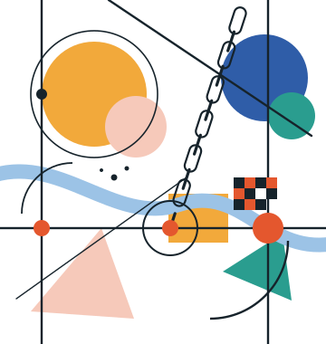

```{=html}
<div class="hero">
  <div class="hero-text">
    <p class="hero-name" aria-hidden="true">Oliver Harman</p>
    <p class="lede">I study how power and connection shape economic development:
    how power is distributed within developing countries, and how places connect
    to the global economy.</p>
    <p class="hero-links">
      <a href="cv/harman-cv-abridged.pdf">Abridged CV</a>
      <a href="cv/harman-cv-full.pdf">Full CV</a>
    </p>
  </div>
  <div class="hero-map">
    
  </div>
</div>
```

I am
[Research Officer in Economic Geography and Spatial Economics](https://www.lse.ac.uk/people/oliver-harman)
at LSE's Department of Geography and Environment and Global School of
Sustainability. Alongside this role, I am Lecturer in Urban Economics at the
African School of Economics'
[Africa Urban Lab](https://www.asezanzibar.com/africa-urban-lab) in Zanzibar,
where I have taught since 2024. I submitted my DPhil in Sustainable Urban
Development at the University of Oxford in October 2026, where I am a Doctoral
Affiliate of the Centre for the Study of African Economies and a Research
Affiliate of the Blavatnik School of Government.

[**Fields:** urban and regional economics; political economy of development;
global value chains and foreign direct investment. **Regions:** sub-Saharan
Africa and South Asia.]{.fields}

::: {.featured}
[New book]{.label}

[Green Global Value Chains for Sustainable Development: Environmental Upgrading in a Fragmented Spatial Economy]{.paper-title}

With [Riccardo Crescenzi](https://www.lse.ac.uk/geography-and-environment/people/academic-staff/riccardo-crescenzi),
I argue that green global value chains, and the green foreign direct investment
that helps to build and reconfigure them, can support sustainable development
across a fragmented spatial economy. Our organising idea is environmental
upgrading, and we set out what governments can do with it.

Published by Cambridge University Press in November 2026, free to read on Cambridge Core.

[Read it free](https://doi.org/10.1017/9781009623766) &nbsp; [About the book](green-global-value-chains.qmd) &nbsp; [Launch event, 18 November](https://www.lse.ac.uk/events/global-value-chains)
:::

::: {.wip}
[Recently published]{.label}

- *[Unequal Progress and Barriers for Women in Economics](https://doi.org/10.21627/aekcyv04)*. [With [O. Berland](https://www.ondineberland.com/) and [N. Moreau-Kastler](https://ninonmoreaukastler.com/). Reviews of Economic Literature, 2026]{.with}

[Work in progress]{.label}

- *[Decentralisation by Proliferation in Uganda](research.qmd#featured-paper)*. [Single-authored]{.with}
- *Local Authorities without Means in Guyana*. [Single-authored]{.with}
- *Moving the Seat of Government and the Growth of African Towns*. [Single-authored]{.with}
- *Measuring Metropolitan Authority in Africa: A Regional Authority Index for Eight Countries, 1994–2024*. [With J. Hayward and G. Sampó]{.with}
- *Green Foreign Direct Investment in Africa*. [With [J. Alvarez-Vilanova](https://www.lse.ac.uk/geography-and-environment/people/phd-students/juan-alvarez-vilanova), [R. Crescenzi](https://www.lse.ac.uk/geography-and-environment/people/academic-staff/riccardo-crescenzi) and [C. Lippitsch](https://sites.google.com/view/christianlippitsch)]{.with}
- *[Transforming Small and Medium Enterprise Integration into Global Value Chains](https://www.theigc.org/sites/default/files/2026-10/Harman%20and%20Shukla%20Working%20Paper%20September%202026.pdf)*. [With R. Shukla. IGC Working Paper, 2026]{.with}
- *Measuring Urban Growth from Built Cover Where the Census Is Old*. [With [S. Franklin](https://www.simonfranklin.co/), G. Kakoulaki, K. Molla and M. Read]{.with}
- *Valuing Land with Auctions: Implications for Land Taxation in Addis Ababa*. [With [S. Franklin](https://www.simonfranklin.co/), S. T. Mengistu and K. Molla]{.with}

[All working papers and abstracts](research.qmd#working-papers)
:::

On power, my thesis, *Power and Place*, asks how power is distributed within
African states and what follows for local economic development. I treat the
power of urban governments as three things that need not move together:
capacity, how well they perform in the eyes of their citizens; authority, what
the law formally grants them; and means, the fiscal resources behind both. I
measure each, drawing on two decades of Afrobarometer surveys, a model-assisted
coding of metropolitan legislation since the early 1990s, and IMF fiscal data,
and then trace what they do for local public goods and for Uganda's new cities,
where status and resources changed but formal authority did not. On connection, I ask how foreign
investment and global value chains land in particular regions, and whether
those regions capture anything durable from them as the economy turns green.

I came to research from a decade in policy. I worked with mayors, city
governments and national ministries across Africa, Asia and the Caribbean: as
Cities Economist and then Senior Policy Economist on the International Growth
Centre's [Cities that Work](https://www.theigc.org/initiatives/cities-work)
initiative, and before that as an ODI Fellow embedded in Guyana's Ministry of
Communities. I was focal point for city programmes with UN-Habitat, the
European Commission and the UK's FCDO, and my [policy research](policy.qmd)
has 61 externally validated instances of uptake by decision-makers across 27
countries.

I [teach](teaching.qmd) urban economics at LSE and the Africa Urban Lab, and
co-convened the BREAD-IGC virtual PhD course in urban economics with Edward
Glaeser. In 2026 I received the Class Teacher Award in LSE's Department of
Geography and Environment.

This site collects my [research](research.qmd), [teaching](teaching.qmd),
[policy research](policy.qmd) and [commentary](commentary.qmd).

My best email is <o.harman@lse.ac.uk>, and I am on
[Google Scholar](https://scholar.google.com/citations?user=SLb3QHIAAAAJ) and
[LinkedIn](https://www.linkedin.com/in/oharman/). If you are ever in London or
Oxford, I am nearly always available for a cup of tea.

## Updates

::: {.updates}
- [Nov 2026]{.date} *Green Global Value Chains for Sustainable Development*, with Riccardo Crescenzi, published by Cambridge University Press on 18 November, open access on Cambridge Core. [Read it free](https://doi.org/10.1017/9781009623766) or see [about the book](green-global-value-chains.qmd).
- [Nov 2026]{.date} ["Can global value chains go green? Trade, investment and the net-zero development challenge"](https://www.lse.ac.uk/events/global-value-chains), an LSE public event marking the book, on 18 November with Erik Berglöf, Riccardo Crescenzi, Ralph de Haas and Daria Taglioni, chaired by Jonathan Pershing. On campus and online.
- [Nov 2026]{.date} ["Can we solve the climate crisis under capitalism?"](https://blogs.lse.ac.uk/lsereviewofbooks/2026/11/09/cop-31-can-we-solve-the-climate-crisis-under-capitalism-nick-stern-robert-falkner-giulia-leonelli-laurie-parsons-riccardo-crescenzi-oliver-harman/), a COP31 feature in LSE Review of Books with contributions from Nicholas Stern, Giulia Claudia Leonelli, Laurie Parsons and Robert Falkner. Riccardo Crescenzi and I wrote ours from [the book](green-global-value-chains.qmd).
- [Nov 2026]{.date} ["From harnessing GVCs to green GVCs: The last chapter became the first"](https://www.regionalstudies.org/news/from-harnessing-gvcs-to-green-gvcs-the-last-chapter-became-the-first/), with Riccardo Crescenzi, for the Regional Studies Association, on how the new book grew out of the final chapter of *Harnessing Global Value Chains for Regional Development*.
- [Oct 2026]{.date} ["Green investment in Africa is larger — and more concentrated — than statistics show"](https://www.theigc.org/blogs/green-foreign-direct-investment-africa), on the IGC blog, from our IGC-funded research on green foreign direct investment in Africa with Juan Alvarez-Vilanova, Riccardo Crescenzi, James Hayward, Christian Lippitsch and Till Meissner.
- [Jul 2026]{.date} ["Unequal Progress and Barriers for Women in Economics"](https://doi.org/10.21627/aekcyv04), with Ondine Berland and Ninon Moreau-Kastler, published in *Reviews of Economic Literature* (open access).
- [Jun 2026]{.date} Spoke on ["Green industrial policy: balancing national goals and global integration"](https://www.lse.ac.uk/events/lse-festival/2026/green-industrial-policy), an LSE Festival panel with Anna Valero, David Willetts and Louise Hellem, chaired by Riccardo Crescenzi. [Video of my contribution](https://www.youtube.com/watch?v=Q4jl9RzZLRU&t=1950s).
- [Jun 2026]{.date} ["Why must a pear cross three continents before reaching a lunchbox?"](https://www.lse.ac.uk/Events/LSE-Festival/2026/LF26-Holdingpowerfultoaccount-foodmiles.pdf), our panel on green global value chains with Riccardo Crescenzi, in [*How to save the planet*](https://www.lse.ac.uk/events/lse-festival/2026/lse-festival-exhibition), the LSE Festival exhibition, from 15 June to 2 July. [Photo and more](green-global-value-chains.qmd#lse-festival).
- [Jun 2026]{.date} ["Made in Britain, or designed in Britain? What Port Talbot teaches us about the green economy"](https://blogs.lse.ac.uk/businessreview/2026/06/13/made-in-britain-or-designed-in-britain-what-port-talbot-teaches-us-about-the-green-economy/), with Riccardo Crescenzi, in LSE Business Review.
- [May 2026]{.date} "Unequal Progress and Barriers for Women in Economics", with Ondine Berland and Ninon Moreau-Kastler, is in press at *Reviews of Economic Literature*.
- [Apr 2026]{.date} Four working papers submitted to the International Growth Centre.
- [Mar 2026]{.date} *Green Global Value Chains for Sustainable Development*, with Riccardo Crescenzi, accepted for Cambridge Elements (Cambridge University Press).
- [Mar 2026]{.date} Presented a paper on public goods in Africa at the [CSAE Conference](https://www.csae.ox.ac.uk/), Oxford.
- [Jan 2026]{.date} Joint work [presented at ASSA](https://www.aeaweb.org/conference/2026/program/1519).
:::
